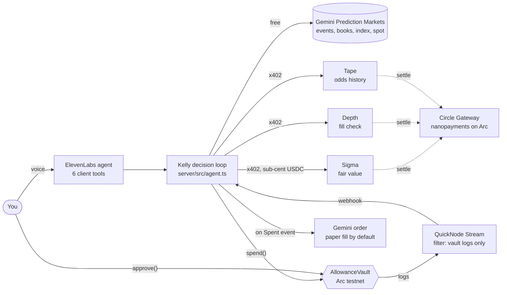

# Kelly

**A prediction-market desk you can talk to, on an allowance it cannot exceed.**

You ask, out loud, "what's mispriced in Bitcoin?" Kelly spends a few cents of USDC buying signals from independent sellers, compares Gemini's odds with its own estimate, sizes the bet with the Kelly criterion, and asks an onchain vault on Arc for the money. Small bets go through. Anything over your limit waits for you to say "approved." Anything over the daily cap is refused by the contract, whatever the agent wants.

Built for the UBC 26 Hackathon, Nov 12–20, 2026. Track: **Agentic Payments and AI**. Chain award: **Best use of Arc**. Bounties: **Gemini Prediction Markets, QuickNode Streams, ElevenLabs**.

> **Status of this build.** The vault is deployed on Arc testnet and the agent has run the full loop against it, paying for its data with real Circle Gateway nanopayments. The QuickNode Stream and the ElevenLabs voice agent are implemented but not yet switched on, and trades are paper fills. See [What is real and what is not](#what-is-real-and-what-is-not).

## The problem

Prediction markets are the best public signal of what will happen next, and AI agents are the obvious users. But handing an agent a funded trading account is reckless, and the usual fix, a spending limit in the agent's own code, is a promise the agent keeps only while its code and its model behave.

Kelly splits the roles. The agent can think, pay for data and ask for money. Only a contract can release money, and only the human can raise the limits.

## Try it in two minutes

Needs Node 20 or newer. No keys, no wallet.

```bash
git clone <this repo> && cd kelly
npm run setup     # installs, creates .env, builds the web app
npm run demo      # http://localhost:8787
```

Type "What's mispriced in Bitcoin?", then "Size a bet", then "Put $500 on it". Odds are live from Gemini. The vault and payments are simulated in-process in this mode, and the header says so.

```bash
npm test          # 10 contract tests + 26 server tests
npm run smoke     # walks the whole demo script against a running server
```

## How it works



### The agent's decision loop

Every step is written to the activity feed, so the loop is visible while it runs. Source: [`server/src/agent.ts`](server/src/agent.ts).

1. **Discover** (free). List Gemini's open price-ladder events for the asset and take the next three to settle that are at least 45 minutes out.
2. **Fund data** (onchain). If the nanopayment balance is under $0.05, call `vault.spend(agent, $1)`. It is inside the auto-approve limit and counts against the daily cap.
3. **Buy fair value** (paid, $0.005 per event). Sigma returns the model probability for every strike.
4. **Rank**. For each strike, edge = model probability of the side minus the price actually paid to cross the spread. Keep the best one between 3 and 15 points. Under 3 is noise. Over 15, Kelly assumes its model is the one that is wrong.
5. **Buy fill check and tape** (paid, $0.002 and $0.001). Depth walks the live order book to see how much fills inside the limit price. Tape adds odds history and index momentum.
6. **Size**. Half-Kelly on the vault balance: `f = (p − price) / (1 − price) × 0.5`. Capped by today's remaining allowance and by book depth.
7. **Ask the vault**. `vault.spend(tradingAccount, stake, memo)`. The contract pays it, queues it for the owner, or reverts.
8. **Wait for the chain**. The order is placed only when the vault's `Spent` event for that memo arrives. The agent's own belief that it was funded is not enough.
9. **Execute**. Limit order two cents through the quote: a paper fill against Gemini's live book, or a real order if trading keys are set.

### Safety limits

| Limit | Where it is enforced | Default |
|---|---|---|
| Daily spending cap | `AllowanceVault` contract | $50 |
| Auto-approve limit; above it the owner must approve | `AllowanceVault` contract | $10 |
| Payee allowlist (trading account, agent's data wallet) | `AllowanceVault` contract | 2 addresses |
| Kill switch | `AllowanceVault.setPaused`, owner only | off |
| Pending requests expire | `AllowanceVault` contract | 1 hour |
| Agent key can call `spend()` and nothing else | `AllowanceVault` contract | always |
| Max price per data call | Circle SDK `onBeforePaymentCreation` hook | $0.02 |
| Data budget per session | same hook | $0.50 |
| Seller allowlist | same hook | 3 sellers |
| Minimum and maximum believable edge | decision loop | 3 and 15 points |
| Voice approval needs the human's own words | browser, not the LLM | regex on the last user utterance |

On the last row: `approve_request` is a client tool, and the browser runs it only if the most recent thing the user said contains an approval word. The language model cannot approve its own request by calling the tool.

**A limit that is weaker than it looks.** In this build the server holds the owner key so that "approved" by voice or button can sign `approve()`. That is a demo convenience. In production the owner signature belongs on the owner's device (a passkey or a Circle user-controlled wallet), and the server would hold only the agent key.

### Economic design and risk assumptions

- **The model is a sanity check, not an edge.** It is a driftless lognormal on the event's reference index. Volatility is the realised volatility of the last 24 hours of 5-minute index candles. The current level is the mid of Gemini's spot order book, because the index candles trail real time by several minutes and a stale level fakes large edges on short-dated markets. We found this the hard way: the first version reported a 51-point "edge" that was only lag.
- **Basis risk.** Events settle on Lukka's reference rate; the model reads Gemini spot. They differ slightly.
- **No drift, no jumps, no skew.** Realised volatility understates tail risk. Half-Kelly and the 15-point ceiling are there because the model deserves limited trust.
- **Costs.** Edge is measured after crossing the spread. Gemini's trading fees are not modelled.
- **Custody.** The vault holds USDC on Arc. A trade is funded by releasing USDC to a trading-account address. With real Gemini trading that address would be the user's Gemini USDC deposit address; on testnet it is a plain wallet and no funds reach Gemini.
- **Sellers.** All three signal sellers ship in this repo. The payment between agent and seller is real x402; the independence of the sellers is not.

## Sponsor technology

### Gemini Prediction Markets

Gemini is the market, the model input and the execution venue. Client: [`server/src/gemini.ts`](server/src/gemini.ts).

| Endpoint | Used for |
|---|---|
| `GET /v1/prediction-markets/events` | Discovery of open price-ladder events |
| `GET /v1/prediction-markets/events/{ticker}` | Strikes, bid and ask per contract, reference index |
| `GET /v1/book/{instrumentSymbol}` | Order-book walk for sizing and paper fills |
| `GET /v2/klines` (Lukka index) | Realised volatility |
| `GET /v1/pubticker/{pair}` | Live index level |
| `POST /v1/prediction-markets/order` | Live orders, off by default |

Against the bounty's objectives: the ladder chart shows the market's implied odds next to a model for every strike (analytics); Kelly is an agent that acts on the data with sized, limit-priced orders (trading tools); the voice interface answers "what's mispriced?" in one sentence (discovery); and Tape records odds history, which Gemini's API does not serve for contracts.

### Arc and Circle

- **`AllowanceVault`** ([`contracts/contracts/AllowanceVault.sol`](contracts/contracts/AllowanceVault.sol)) holds USDC through the ERC-20 interface at `0x3600…0000` and enforces every limit in the table above. Deployed with Hardhat.
- **Gateway nanopayments.** In `PAY_MODE=gateway` the agent pays sellers with `GatewayClient.pay()` from `@circle-fin/x402-batching` 4.0, and the sellers charge with `createGatewayMiddleware().require()`. The data-spend policy runs inside the SDK's `onBeforePaymentCreation` hook, so an over-limit payment is never signed. Code: [`server/src/pay.ts`](server/src/pay.ts), [`server/src/sellers.ts`](server/src/sellers.ts).
- **USDC as gas.** The agent wallet holds one asset. The same USDC pays for gas, data and bets.

Addresses on Arc testnet (chain 5042002):

| Contract | Address |
|---|---|
| AllowanceVault | [`0xd6cd15d175608084e70bd1d1dbbe6538b4810630`](https://explorer.testnet.arc.io/address/0xd6cd15d175608084e70bd1d1dbbe6538b4810630) |
| Agent wallet | `0x5E646b2f313B616C181009038236C98F6f22Dbe7` |
| Trading account (stake recipient) | `0x6948A6cbCd4b047b3ae26D47718aa652C5294394` |
| USDC | `0x3600000000000000000000000000000000000000` |
| Circle GatewayWallet | `0x0077777d7EBA4688BDeF3E311b846F25870A19B9` |

Transactions from the first live run (Nov 16):

| What happened | Transaction |
|---|---|
| Vault deployed | [`0x8098ce48…9dc6`](https://explorer.testnet.arc.io/tx/0x8098ce48dd5ba9f98f991ddcbd742a03a738e5d564b3017b5592db9cc19f9dc6) |
| Agent asked for $0.82, over the limit: `SpendRequested` | [`0x2e0bcff5…b2d5`](https://explorer.testnet.arc.io/tx/0x2e0bcff5af2f04107b04f90240c74e0df8f93c6453fc21047cd134c93034b2d5) |
| Owner approved: `Spent` | [`0x3dfe14c6…3509`](https://explorer.testnet.arc.io/tx/0x3dfe14c63edc094774aae6715fe57e535dd2d9847cca04d3c9ad5ffe0a7e3509) |
| Small bet inside the limit: `Spent`, no approval | [`0xc628fe95…370e`](https://explorer.testnet.arc.io/tx/0xc628fe951fe6edf6b7949861bbd63804319efbf5ff6139b03689333c6b9f370e) |
| Owner changed the policy | [`0x4f970d3c…3cb4`](https://explorer.testnet.arc.io/tx/0x4f970d3c57f349c92bb88225910560a652baa62c581ed77206aff4ecd6aa3cb4) |

The $500 request has no transaction: the contract's `DailyCapExceeded` revert is caught in simulation, so the agent never pays gas for a refusal. Nanopayments settle in Circle Gateway batches and are identified by Gateway transfer ids in the activity feed, not by one transaction each.

The testnet vault holds about 13 USDC, so its limits are scaled down: auto-approve $0.25, daily cap $5.

### QuickNode Streams

The Stream is what tells Kelly that money moved. With `EVENT_SOURCE=quicknode` the RPC poller is off, and the approval card, the ledger and the order trigger all come from Stream deliveries.

| Setting | Value | Why |
|---|---|---|
| Network | Arc testnet | where the vault lives |
| Dataset | `block_with_receipts` | logs with their transaction hashes |
| Filter | keep logs whose `address` is the vault, drop the block otherwise ([`server/src/quicknode.ts`](server/src/quicknode.ts)) | the webhook gets a few hundred bytes per relevant block and nothing else |
| Start | the vault's deploy block | backfills history after a restart |
| Destination | webhook `POST {PUBLIC_URL}/webhooks/quicknode` | pushes into the same handler as every other event source |
| Auth | shared secret in a custom `X-Kelly-Token` header, compared in constant time | set on the destination, checked on every delivery |

No API key, or the API rejects it? `npm run quicknode:manual` prints the same settings and the filter function to paste into the QuickNode dashboard, with the secret carried as `?token=` on the webhook URL.

If a delivery is more than 12 seconds late, Kelly catches up once over RPC and labels that ledger line `rpc-fallback`. Create the Stream with `npm run quicknode:setup`. Test the path without a public URL with `npm run stream:replay`, which runs the same filter function locally.

### ElevenLabs

Voice is the interface. Products used: **ElevenLabs Agents** (speech in, hosted LLM, speech out) through `@elevenlabs/react` 1.22, and **text-to-speech** for the typed console.

The agent has six client tools that run in the browser and call Kelly's API: `find_mispricing`, `size_bet`, `approve_request`, `deny_request`, `get_status`, `set_paused`. The agent's LLM never produces a number: every tool returns a sentence written by the server from real data, and the prompt tells the agent to relay it. Create the agent with `npm run elevenlabs:setup` ([`server/scripts/setup-elevenlabs.ts`](server/scripts/setup-elevenlabs.ts)).

## What is real and what is not

| Piece | Demo mode (default) | Live mode | Verified? |
|---|---|---|---|
| Gemini odds, books, index | live API, falls back to a recording | same | Yes, live |
| Vault | in-memory mirror of the contract's rules | `AllowanceVault` on Arc testnet | Yes. Deployed, and the full loop has run against it. |
| Data payments | real 402 handshake and EIP-712 signature, local facilitator | Circle Gateway on Arc testnet | Yes. Eight payments settled through Gateway in the first live run. |
| Vault events | in-process | QuickNode Stream, or RPC polling | RPC polling verified on Arc. Filter and webhook tested with a local replay. **Stream not yet created.** |
| Voice | typed console, browser or ElevenLabs TTS | ElevenLabs agent | **Agent not yet created; no key during the build.** |
| Trades | paper fill against the live Gemini book | Gemini order API | Paper fills tested. **Live order code is written from the docs and has never run.** |

The header of the app shows which of these is live at any moment. Dashed chips are simulated.

## Going live on Arc testnet

1. `npm run keys` generates wallets into `.env` and prints the addresses.
2. Fund the **owner** and **agent** addresses with testnet USDC at [faucet.circle.com](https://faucet.circle.com) (choose Arc Testnet). The agent needs a little for gas.
3. `npm run deploy:arc` deploys the vault, allowlists payees and deposits `VAULT_DEPOSIT_USDC`. Change limits later with `npm run policy -- <autoApprove> <dailyCap>`.
4. In `.env` set `CHAIN_MODE=rpc`, `PAY_MODE=gateway`, `DEPLOYMENT=arcTestnet`.
5. Get a public URL (below), set `PUBLIC_URL`, then `npm run quicknode:setup`.
6. Set `ELEVENLABS_API_KEY`, then `npm run elevenlabs:setup`.
7. `npm run demo`.

### Public URL

QuickNode has to reach the webhook. The quickest way is a Cloudflare quick tunnel, which needs no account:

```bash
# Linux
curl -L -o cloudflared https://github.com/cloudflare/cloudflared/releases/latest/download/cloudflared-linux-amd64
chmod +x cloudflared
./cloudflared tunnel --url http://localhost:8787
```

It prints a `https://….trycloudflare.com` address. Put that in `.env` as `PUBLIC_URL`. The address changes every time the tunnel restarts, so recreate the Stream if it does. ngrok works the same way: `ngrok http 8787`.

### Local chain

```bash
npm run chain          # terminal 1: Hardhat node
npm run deploy:local   # terminal 2: deploys MockUSDC and the vault, deposits 200
# .env: CHAIN_MODE=rpc  DEPLOYMENT=localhost  RPC_URL=http://127.0.0.1:8545
#       OWNER_PRIVATE_KEY / AGENT_PRIVATE_KEY = Hardhat accounts #0 and #1
npm run demo
```

## Repository

```
contracts/   AllowanceVault.sol, tests, deploy script (Hardhat)
server/      src/agent.ts     decision loop and tools
             src/model.ts     fair value, Kelly sizing, order-book walk
             src/gemini.ts    Gemini market-data client with fixture fallback
             src/pay.ts       x402 payer, data-spend policy, local facilitator
             src/sellers.ts   three paid signal endpoints
             src/vault.ts     contract adapter and its in-memory mirror
             src/quicknode.ts Stream filter and webhook auth
             src/venue.ts     paper fills and Gemini orders
web/         React app: voice, ladder chart, allowance, approval card, activity feed
docs/        demo script, pitch outline, submission answers
```

Contracts use Hardhat 2.20 rather than 3.x or Foundry because it is pure JavaScript and installs anywhere, including older Linux machines.

## What's next

- Owner approval by passkey on the owner's phone, so the server never holds the owner key.
- Fit the implied volatility and forward from the ladder itself and trade the gap to realised volatility, which removes the spot-lag problem entirely.
- List the sellers in Arc's ERC-8004 registries so agents can discover and rate them.
- Real third-party sellers, and Gemini's WebSocket for books instead of polling.

## Team

Solo build.

_Not financial advice. Prediction-market trading is restricted in some jurisdictions; live trading is off by default._
